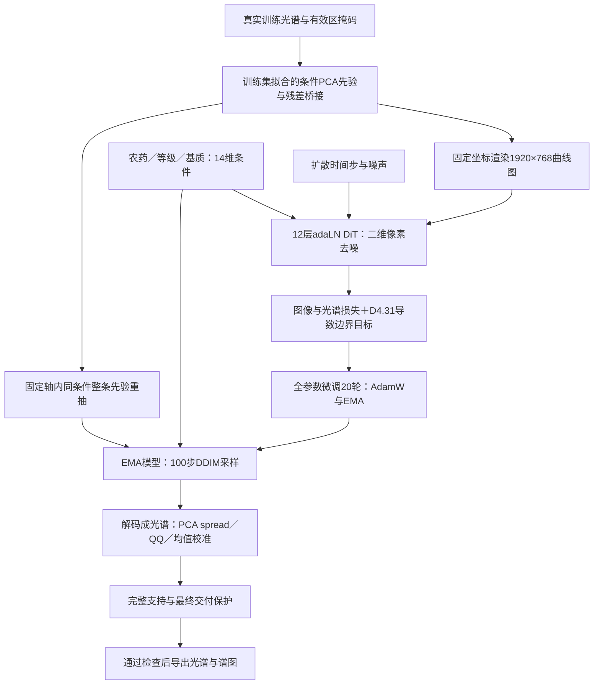
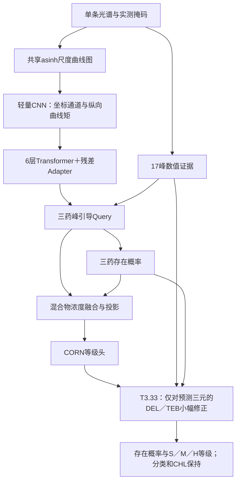

# SERS 条件谱图扩散生成与 Transformer 识别

本仓库研究水、土壤基质下 DEL、CHL、TEB 的单药、双药和三药组合。当前 main 推荐两个分别训练的模型：**D4.31 第20轮二维曲线图 DiT 生成模型**，以及 **T3.32 图像 CNN＋Transformer 主体与 T3.33 第4轮三元修正组成的识别模型**。

此次只更新必要的源码和新增文件，不删除旧对照，不上传数据、权重、运行日志或缓存。T3.33 识别代码已是保留版本，不因本次生成端更新而重训或改写。

## 当前版本

| 项目 | 扩散生成端 | 识别端 |
|---|---|---|
| 推荐版本 | D4.35 长训练对照中的 D4.31，epoch20／step1900，EMA | T3.32 epoch16＋T3.33 epoch4 |
| 网络 | 全高度条带 CurveImageDiT2D，12层、512维、8头 | 轻量二维CNN、6层128维Encoder、Adapter、峰查询和数值峰证据 |
| 参数 | 83,083,776 | T3.32 1,399,975；含T3.33共1,423,915 |
| 表示 | 1920×768固定坐标曲线图，768×16 patch、120 token | 2048×512共享asinh尺度曲线图＋17峰窗口数值证据 |
| 当前训练方式 | 原50轮基础模型后额外20轮全参数微调，lr=1e-5固定 | 冻结原二维识别主体，仅训练23,940个修正参数 |
| 输出 | 光谱图像及解码、保护后的Raman轴／强度 | 农药存在概率与S/M/H有序浓度等级 |
| 统一入口 | [diffusion/run_generation.py](diffusion/run_generation.py) | [transformer/run_recognition.py](transformer/run_recognition.py) |
| 加载／调度 | [current_diffusion.py](diffusion/current_diffusion.py) | [current_recognition.py](transformer/current_recognition.py) |
| 版本登记 | [D4.31 selection](current_configs/D4.31/selection.json) | [T3.33模型配置](current_configs/T3.33/model_config.json) |

**训练权重仍在原服务器，不在仓库中。** 当前生成checkpoint记录的SHA256为 `be2bf6411894d51de8d4e20cc95512cf4e1a9805cddd1f3a020bbab1450340ea`，识别checkpoint记录为 `09b6ccfdb9368eef298bec8e8525227d109b984f8581c945a9ba0a29d02d1b99`。具体服务器路径、版本和评价口径见 [CURRENT_MODEL.json](CURRENT_MODEL.json)。这些记录不是GitHub中的模型文件或下载地址。

## 生成模型与数据流

126个条件共享一个DiT，条件字符串如 `DEL-H_TEB-S_water` 由规则解析为14维条件向量。没有自由文本编码器。PCA底谱、残差变换、强度归一化均使用对应真实训练谱拟合。实际扩散对象是二维曲线像素；旧U-Net与一维DiT代码仍可用于历史对照。

二维范围固定为归一化[-1.5,1.5]。先验越界时整条重抽，记录审计；不逐点裁剪、不修改坐标、不放宽最终保护。D4.31辅助损失预算2%指损失值上限，不代表梯度上限。其训练扩展保留实际实验文件名和SHA256保护。

生成及评价命令见 [diffusion/README.md](diffusion/README.md)。新入口默认使用选定EMA权重、每条件50条；生成及评价输出写入新目录。常规评价直接运行，**不会先加载FID，也不会下载FID权重**。

## 识别模型与数据流

识别端保持当前T3.33：从数值光谱绘制共享尺度折线图，以二维CNN和Transformer提取特征，结合17个峰窗口数值证据，预测三种农药存在概率和有序等级。推理不输入真实标签、文件名或组合ID。

T3.35头微调没有合格提升；T3.36终端摘要同样记录未获合格提升，正式报告尚未收录。两者保留为对照，不自动替代T3.33。识别端的 [使用说明](transformer/README.md)、[当前加载接口](transformer/current_recognition.py) 和模型源码保持原样。

## 当前验证结果

生成端比较9组同预算实验，每组126个条件、每条件50条生成谱，以4条真实验证谱为参考；只有一个训练种子。

| 轮次 | 组别 | 一阶导数Pearson ↑ | 绝对边界跳变量 ↓ |
|---|---|---:|---:|
| 5 | control | 0.796381 | 6.575198 |
| 5 | D4.31 | 0.802191 | 6.316328 |
| 5 | D4.32 | 0.801564 | 6.337113 |
| 10 | control | 0.796343 | 6.590636 |
| 10 | D4.31 | 0.805230 | 6.207894 |
| 10 | D4.32 | 0.804286 | 6.241939 |
| 20 | control | 0.795366 | 6.599844 |
| 20 | **D4.31** | **0.807751** | **6.076895** |
| 20 | D4.32 | 0.806219 | 6.134368 |

D4.31第20轮对同轮control：126/126条件导数改善，126/126条件边界跳变下降，绝对跳变量宏平均降低7.92%。其归一化光谱MSE约0.00111330、平均光谱MSE约59.5925；第10轮D4.31的归一化MSE略低，control第20轮的平均谱MSE略低，因此不能称所有指标第一。详见 [9组完整摘要](current_configs/D4.35/nine_view_summary.csv)、[逐条件改善数量](current_configs/D4.35/paired_comparison_counts.csv)和 [选择协议](current_configs/D4.31/selection.json)。

生成端仍有明显周期边界异常、122/126条件QQ尾部不足、峰宽IQR比宏平均约1.361。FID未计算。往返检查误差小不等于采样内部保护没有影响。

识别端保留T3.33第4轮，以下来自504条真实验证谱：

| 指标 | 正确数 | 准确率 |
|---|---:|---:|
| 农药组成全部正确 | 504/504 | 100% |
| 已存在农药等级正确 | 1027/1152 | 89.15% |
| 组成和全部等级均正确 | 408/504 | 80.95% |
| 三元三药等级均正确 | 133/216 | 61.57% |

[识别验证表](current_configs/T3.33/validation_metrics.json)。两个模型分别训练，当前识别模型使用的既有生成训练谱不等于新D4.31生成谱；**未证明当前生成端提高了下游识别或浓度预测**。上述结果不是独立测试集结果，也不是多种子显著性结论。

## 数据划分与复现边界

真实数据126源文件×20条，共2520条。每文件固定12训练／4验证／4测试，共1512／504／504。PCA、先验与归一化仅拟合训练部分。这是同源文件内部划分，不能称为独立批次、独立仪器或未见条件验证。

选择依据来自用户上传的实际报告，结果表哈希与checkpoint登记一致；原始训练权重及数据未传入本次代码更新环境，不声称重新运行了真实GPU实验。统一入口已通过小型合成数据的实际生成、评价及已有回归检查；验证范围记录在发布检查说明中。

## 文件索引

- [CURRENT_MODEL.json](CURRENT_MODEL.json)：当前推荐版本、外部权重位置与评价口径。
- [current_configs/](current_configs)：当前配置与验证摘要；D4.27等旧目录是历史对照。
- [diffusion/](diffusion)：二维生成核心、训练扩展和独立评价入口。
- [transformer/](transformer)：保持T3.33为推荐的完整识别代码与微调对照。
- [FILE_GUIDE.md](FILE_GUIDE.md)：逐项功能索引及本次新增入口。
- [SOURCE_SHA256.json](SOURCE_SHA256.json)：更新后的源码／配置／文档指纹。
- `packages/`：原有实验包及固定运行依赖；不因版本号较旧而删除。

旧D4.27一维DiT、旧识别基础和T3.35／36对照均保持在仓库供审计和复现；不属于本次新增推荐权重。新增代码不自动启用LoRA、Adapter微调或MoE，也不安装依赖或发送网络下载请求。
