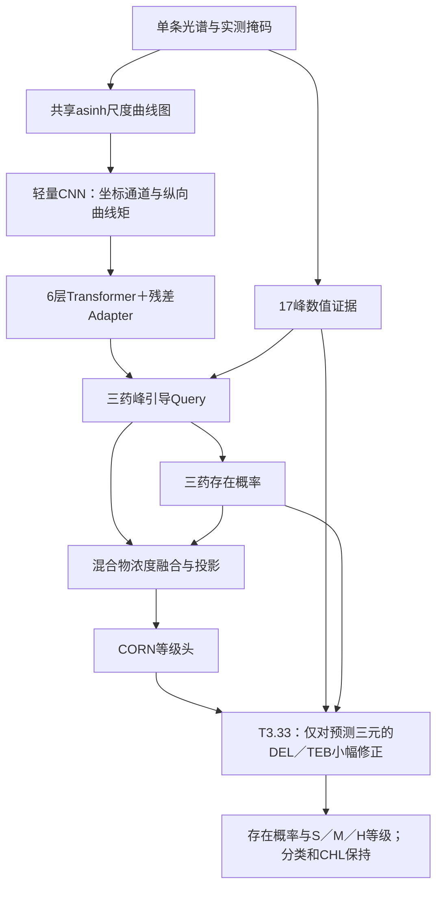

# SERS 条件谱图扩散生成与 Transformer 识别

本项目研究水和土壤基质中 DEL、CHL、TEB 的单药及混合物光谱。当前生成端为**固定条件均值的二维残差 DiT**，识别端使用 **T3.32＋T3.33**。

## 扩散生成

每个条件使用 12 条训练谱拟合均值和残差尺度。模型在 1920×768 二维残差图上学习和采样，使用 120 个 768×16 条带 patch。EMA 采样使用 ridge_0 输出，解码后通过逆变换和加回条件均值重建完整谱。可对重建谱执行三点中值滤波和条件内 PCA 扰动，生成增强候选。

生成、后处理及 126 组评价从 [diffusion/run_generation.py](diffusion/run_generation.py) 运行，命令见 [生成说明](diffusion/README.md)。训练权重和 prepared 数据从实验存储取得。此前的 D4.31 实验使用 [历史入口](diffusion/run_generation_d431.py)。

## 生成验证结果

126 个条件各评价 50 条生成谱，每组以 4 条真实验证谱为参考。下表为 126 组中位数。

| 指标 | 原版 | 中值滤波 | 中值滤波＋PCA |
|---|---:|---:|---:|
| 多样性比 | 0.130 | 0.128 | 0.314 |
| MMD² | 0.1790 | 0.1793 | 0.1576 |
| 切片 Wasserstein | 0.01619 | 0.01619 | 0.01508 |
| 一阶差分 Pearson | 0.98442 | 0.98454 | 0.98454 |
| COS | 0.98226 | 0.98229 | 0.98032 |
| 漏峰率 | 10.53% | 10.81% | 12.56% |

验证显示加入 PCA 后多样性和分布相似度改善，同时漏峰率上升。背景 MAD 比仅在 31 组有定义。真实数据为 126 个条件各 20 条谱，按同源文件固定划分 12 条训练、4 条验证和 4 条测试。生成端结果来自验证集。

## 识别模型与数据流

识别端保持当前T3.33：从数值光谱绘制共享尺度折线图，以二维CNN和Transformer提取特征，结合17个峰窗口数值证据，预测三种农药存在概率和有序等级。推理不输入真实标签、文件名或组合ID。

T3.35头微调没有合格提升；T3.36终端摘要同样记录未获合格提升，正式报告尚未收录。两者保留为对照，不自动替代T3.33。识别端的 [使用说明](transformer/README.md)、[当前加载接口](transformer/current_recognition.py) 和模型源码保持原样。

## 识别验证结果

识别端保留T3.33第4轮，以下来自504条真实验证谱：

| 指标 | 正确数 | 准确率 |
|---|---:|---:|
| 农药组成全部正确 | 504/504 | 100% |
| 已存在农药等级正确 | 1027/1152 | 89.15% |
| 组成和全部等级均正确 | 408/504 | 80.95% |
| 三元三药等级均正确 | 133/216 | 61.57% |

[识别验证表](current_configs/T3.33/validation_metrics.json)。现有识别验证使用各自的训练流程。新生成谱的下游增益尚未评估。

## 文件索引

- [当前扩散模型登记](diffusion/fixed_mean_residual/model.json) 记录生成架构、运行入口和评价口径。旧版 [CURRENT_MODEL.json](CURRENT_MODEL.json) 保留原版本登记。
- [diffusion/](diffusion) 包含生成、后处理及评价入口。
- [transformer/](transformer) 包含识别入口和模型实现。
- [FILE_GUIDE.md](FILE_GUIDE.md) 包含当前入口及历史实验索引。

## 复现所需的实验文件

运行前从实验存储取得配套权重、prepared 数据及服务器原始 provenance.json。该文件放在 diffusion/fixed_mean_residual/，由原始清单校验。
