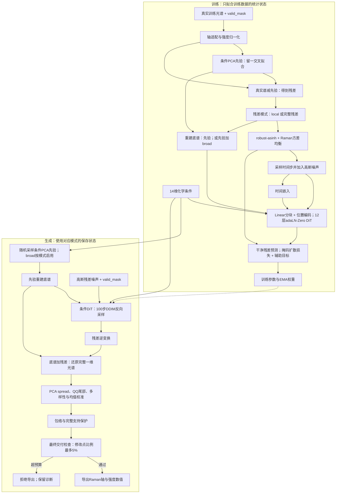
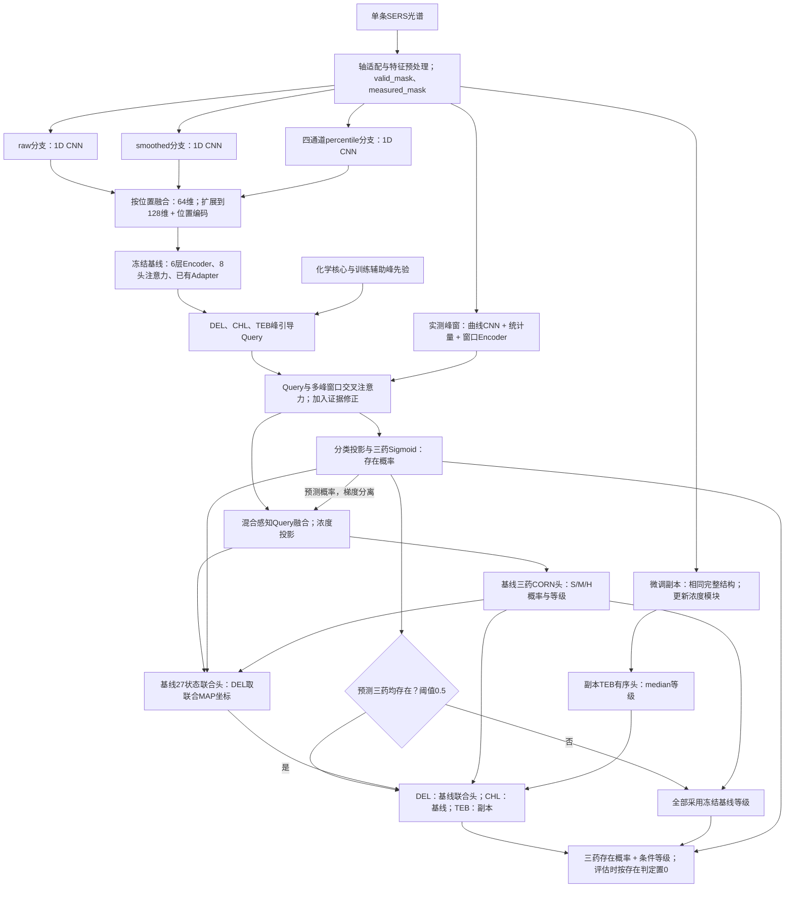

# DiT + Transformer：SERS 光谱生成与农药识别

本项目研究水、土壤基质中 DEL（溴氰菊酯）、CHL（百菌清）和 TEB（戊唑醇）的单药、双药、三药组合。系统包含两个独立训练的模型：**条件先验残差 DiT 生成一维光谱，SERSFormer 识别农药类别并预测 S/M/H 浓度等级**。

当前分支：`DiT+transformer`。生成端版本为 **D4.27**；当前推荐识别模型为 **T3.30 / concentration / TEB_only / epoch 17**。T3.31 是保留的最新对照实验，未取代推荐模型。

## 1. 先从哪里看

| 目的 | 查看位置 |
|---|---|
| 理解两个模型的组成和数据流 | 本 README 第 3、4 节 |
| 查询每个文件、文件夹的简要功能 | [完整功能索引](FILE_GUIDE.md) |
| 查看生成模型的核心实现 | [dit_1d.py](diffusion/src/dit_1d.py)、[model_builder.py](diffusion/src/model_builder.py) |
| 查看当前完整识别模型 | [feature_model.py](packages/sers_t330_feature_finetune/feature_model.py) 及其 `vendor/` 依赖 |
| 查看正式参数 | [D4.27 配置](current_configs/D4.27)、[T3.30 结构](current_configs/T3.30/parent_model_config.json) |
| 查找训练、生成、评价入口 | [生成端说明](diffusion/README.md)、[识别端说明](transformer/README.md)、[实验扩展说明](packages/README.md) |

**`transformer/Model_v2.py` 是基础实现。完整 T3.30 模型必须通过 `feature_model.load_checkpoint` 加载**，才能恢复 Adapter、多峰证据、冻结基线、微调副本与最终路由解码。

## 2. 文件夹和根目录文件

| 名称 | 简要功能 |
|---|---|
| [diffusion/](diffusion) | 生成端：条件先验、残差处理、DiT、扩散采样、保护与评价 |
| [transformer/](transformer) | 识别基础：光谱预处理、SERSFormer、训练与分层评价 |
| [packages/](packages) | 配对实验调度、完整识别扩展及固定路径依赖 |
| [current_configs/](current_configs) | 正式生成配置、推荐识别结构和验证摘要 |
| [README.md](README.md) | 项目总说明、模块作用、流程图、参数和使用入口 |
| [FILE_GUIDE.md](FILE_GUIDE.md) | 所有文件和文件夹的逐项功能说明 |
| [CURRENT_MODEL.json](CURRENT_MODEL.json) | 当前模型版本、推荐权重位置与评价口径 |
| [SOURCE_SHA256.json](SOURCE_SHA256.json) | 当前文件的 SHA256 内容校验清单 |
| [ARCHIVE_VERIFICATION.json](ARCHIVE_VERIFICATION.json) | 原始归档的源码与实验包核验记录 |
| [CLEANUP_REPORT.json](CLEANUP_REPORT.json) | 旧补丁和副本的清理清单及验证结果 |
| [.gitignore](.gitignore) | 防止数据、权重、输出及缓存误提交 |

保留的 `vendor/archived` 是完整识别模型的运行与校验依赖。D4.27 的 `payload` 和 `test_fixtures` 分别供安装器和测试读取。它们有固定用途，不能按“同名”或“旧版本号”删除。

GitHub 文件列表右侧文字来自最后一次提交，并没有独立可编辑的文件备注字段。根目录文档与说明文件采用功能化提交说明；逐文件功能以 [FILE_GUIDE.md](FILE_GUIDE.md) 为准。受校验保护的代码保持原内容与历史。

## 3. 模型一：条件先验残差 DiT

### 功能

输入化学条件、随机噪声和训练先验，输出 Raman 轴与强度数值组成的光谱。网络学习真实光谱相对条件底谱的残差，再将生成残差与底谱相加还原完整光谱。126 个条件共享一个条件 DiT 网络，各条件的 PCA 与残差状态只使用该条件 12 条真实训练谱拟合。

| 残差模式 | DiT 学习内容 | 光谱重建 |
|---|---|---|
| `broad_local` | 高斯分解后经缩放的 local 残差 | 外层 PCA 先验 + broad PCA 采样 + local 逆变换 |
| `full_residual` | 经缩放的完整先验残差 | 外层 PCA 先验 + 完整残差逆变换 |

两组使用同样的纯 DiT 骨架，分别训练、保存自己的残差尺度和 checkpoint。`full_residual` 不做 broad/local 拆分；残差均为实值一维数据。

### 模块和作用

| 模块 | 主要文件 | 作用 |
|---|---|---|
| 光谱读取、轴适配与掩码 | `spectrum_file_reader.py`、`spectrum_length_adapter.py`、`spectrum_dataset.py` | 统一物理轴并标记未实测区域，避免填充值参与有效区学习 |
| 强度归一化 | `intensity_normalizer.py` | 训练有效点拟合 global min-max，保存正反变换状态 |
| 条件 PCA 先验 | `conditional_prior_residual.py`、`prior_residual.py` | 保存各条件均值、PCA 变化和先验底谱；训练采用留一交叉拟合 |
| 残差处理 | `broad_local_residual.py` | 选择 local 或完整残差，执行 robust-asinh 和 Raman 方差均衡 |
| 条件编码 | `spectrum_conditioning.py` | 将农药、等级、组合与基质解析为 14 维条件 |
| Linear 分块与位置编码 | `dit_1d.py` | 将带噪残差、掩码和底谱按每 8 点投影为 token，保持 Raman 顺序 |
| 时间、条件与 adaLN-Zero | `dit_1d.py` | 时间和化学条件的嵌入相加，调制各层注意力与 MLP |
| 全局自注意力 | `DiTBlock` | 学习不同峰段和全光谱之间的联系，排除完全无效 patch |
| 掩码扩散与训练 | `masked_diffusion.py`、`ddpm_trainer.py` | 正向加噪、干净残差预测、min-SNR 权重、EMA 与模型保存 |
| 条件多样性和质量目标 | `conditional_diversity_constraints.py`、`conditional_spectrum_constraints.py` 等 | 在配置预算内约束成对残差几何、方差、重建与完整光谱支持 |
| 校准、交付和评价 | `spectrum_generator.py`、`final_spectrum_delivery.py`、`sers_generation_evaluator.py` | 校准生成分布，保护强度和负谷，评价相似性、分布和多样性 |

DiT 核心使用 Transformer，没有卷积去噪层、U-Net 编解码和 VAE。仓库中的旧 U-Net 模块用于兼容与对照，并非当前 DiT 的去噪骨架。

正式配置开启条件多样性和 `quality_fidelity`。独立物理约束、独立峰导数、相对峰强、峰参数、局部峰分布及峰形多样性项关闭；源码中存在某模块不等于当前实验启用了它。

### 机理流程图

最终生成依次经过 PCA spread、QQ 尾部与多样性保护、均值、包络及完整支持保护。终端交付检查最多允许修改 5% 的点，超预算时拒绝导出，不能自动放宽阈值。

## 4. 模型二：SERSFormer 识别与等级预测

### 功能

输入单条光谱，输出 DEL/CHL/TEB 的存在概率与 S/M/H 等级。完整模型由冻结基线和微调副本组成，两条网络拥有独立权重并分别前向计算。基线保留稳定预测，副本用于受控调整浓度特征。

| 模块 | 实现位置 | 作用 |
|---|---|---|
| 光谱预处理与掩码 | `transformer/Dataset.py` | 构造 raw、smoothed、四通道 percentile、raw_intensity、valid_mask 和 measured_mask |
| 三分支 1D CNN | 归档 `Model_T3_26.py` | 分别提取原始、平滑和不同百分位强度层次的局部特征 |
| 融合、扩维与位置编码 | `Model_T3_26.py` | 按位置融合为 64 维，扩到 128 维注意力空间，保留 210 token 路径 |
| Encoder-Only Transformer | `Model_T3_26.py` | 六层、八头全局注意力，建模远距离峰段关系 |
| Residual Adapter | `peft.py` | 每层 Encoder 的 128→16→128 残差适配器；当前继承已有权重 |
| 峰引导 Query Attention | `Model_T3_26.py` | 三药各一个 Query；化学与训练峰先验作为软偏置，不屏蔽其他有效波段 |
| 多峰证据 | `MultiPeak_T3_25.py` | 17 个实测峰窗的曲线 CNN、9 个统计量、窗口 Encoder 与 Query 交叉注意力 |
| 多标签类别头 | `Model_T3_26.py` | 分别输出三药的 Sigmoid 存在概率 |
| 混合感知 Query 融合 | `MixtureAwareQueryFusion` | 浓度路径利用跨药证据及预测存在概率进行融合 |
| CORN 有序等级头 | `Model_T3_26.py` | 预测“≥M”和“≥H”的单调概率，恢复 S/M/H 等级 |
| 三元联合头 | `ternary_model.py` | 对三药等级的 27 种组合进行联合评分 |
| 冻结组合基线 | `combined_model.py` | 三元路由内保留 DEL 的联合 MAP 解码，其他输出保持基线策略 |
| 当前微调与解码 | `feature_model.py` | TEB_only 模式只替换预测三药均存在时的 TEB 等级 |
| 调度与候选保护 | `run_feature.py`、`schedule.py` | 分组学习率、预热余弦、参数锚定及分组表现保护 |

多峰分支用 `measured_mask` 排除未完整实测的峰窗。它利用重叠峰以外的联合线索和窗口统计，不输出解混后的纯农药光谱，也不能据此声称已彻底解决重叠峰判级。

### 机理流程图

当前 `TEB_only` 表示浓度更新方式，仍识别三种农药。预测三药均存在时：DEL 取冻结基线联合头，CHL 取冻结基线有序头，TEB 取微调副本有序头；其他样本回到冻结基线。路由只看模型预测，不用真实标签、文件名或基质标签。

调用完整模型 `predict()` 后直接使用返回等级；不能把 DEL 的边缘概率再次 median 解码来替代联合 MAP 结果。

## 5. 正式参数与数据约定

| 项目 | 生成端 D4.27 | 推荐识别端 T3.30 |
|---|---|---|
| 输入空间 | 一维光谱残差与底谱 | 一维完整光谱及派生特征 |
| 网络参数量 | 57,922,056 | 3,100,203，含冻结基线和副本 |
| 主干 | 12 层 DiT，hidden 512，8 头，patch 8 | 三分支 CNN，128 维注意力，6 层 Encoder，8 头 |
| token | 长轴补至 1904 点，238 patch | 1901 点，210 token |
| 正式训练预算 | 50 epoch，batch 16，seed 2026 | 50 epoch，batch 16，seed 2026；接受 epoch 17 |
| 学习率 | 2e−4，warmup + cosine，最低 1e−6 | 浓度特征 5e−6，等级头 1e−5，3 epoch warmup + cosine |
| 主要补充 | 条件 PCA、先验残差、EMA 0.995、采样校准 | 多峰证据、已有 Adapter、联合头、L2-SP |
| 当前更新参数 | DiT 训练参数 | concentration 组 148,807 |
| 采样或输出 | 扩散 200 步，DDIM 100 步，eta 0，`pred_x0` | 三药存在概率与 S/M/H 等级 |

真实数据固定为 126 源文件 × 20 条，共 2520 条。每源文件 1–12 条训练、13–16 条验证、17–20 条测试，对应 **1512/504/504**。这是同源文件内部划分，不是独立样品或独立批次验证。

原始轴为 1901 点（600–2500 cm⁻¹）或 1401 点（600–2000 cm⁻¹）。生成端对未实测区使用有效区掩码；识别端在内存中按既定背景策略补齐短轴，同时保留实测掩码，不写回原始数据。

PCA、残差状态、训练峰先验与多峰归一化使用对应训练数据拟合。当前 T3.30 训练使用真实 1512 条 + 既有生成 6048 条（每条件 48 条），验证为真实 504 条；这不是 D4.27 新生成谱的下游增益实验。

## 6. 当前结果及报告口径

### 生成端

每条件目标生成 100 条。原 5% 交付阈值下，broad/local 获准 125/126 条件，完整残差获准 116/126 条件。下面仅比较两组**共同获准的 116 条件、验证口径、条件均值再平均**：

| 指标 | broad/local | 完整残差 |
|---|---:|---:|
| 最近验证参考谱 RMSE，原始强度 | 13.4614 | 13.7879 |
| 最近验证参考谱 PCC | 0.968204 | 0.966395 |
| 最近验证参考谱 Cosine | 0.972252 | 0.970695 |
| 成对 MSE 多样性比，接近 1 为匹配 | 1.00716 | 1.08980 |

这些结果不能当成全部 126 条件的完整交付表现。未获准中间光谱只供诊断；相似性高不等于峰形、尾部和多样性全部达标。两种残差缩放域不同，不直接比较训练 loss 的绝对值。

### 识别端

推荐 T3.30 checkpoint 在 T3.31 中进行只读复核，以下为 504 条真实**验证集**结果：

| 指标 | 正确数 / 总数 | 比例 |
|---|---:|---:|
| 三药类别组合全部正确 | 503 / 504 | 99.80% |
| 存在药物浓度等级正确 | 985 / 1152 | 85.50% |
| 类别与全部等级完整正确 | 380 / 504 | 75.40% |
| 三元三药等级全部正确 | 125 / 216 | 57.87% |
| DEL / CHL / TEB 等级正确 | 312 / 351 / 322，各 384 | 81.25% / 91.41% / 83.85% |

主要剩余误差是三元混合浓度判级。本轮 T3.30/T3.31 未预测测试集，验证集已用于多次候选选择，不能把上述结果改称独立测试准确率。S/M/H 是既定浓度等级，等级码 MAE/RMSE 不是物理单位的连续浓度误差。

## 7. 训练、生成、评价与加载

| 操作 | 入口 |
|---|---|
| 准备 DiT 两组实验 | `packages/d4_27_dit_ablation/prepare_run.py` |
| 生成端训练/管线检查 | `diffusion/scripts/start_ddpm_training.py` |
| 逐条件生成与交付 | `diffusion/scripts/generate_conditional_spectra.py` |
| 两组串行/并行调度 | `run_experiment.py` / `run_parallel.py`，位于 D4.27 实验包 |
| 生成分层评价 | `diffusion/scripts/evaluate_d4_2_generation.py` |
| 完整推荐识别模型加载 | `packages/sers_t330_feature_finetune/feature_model.py::load_checkpoint` |
| 识别复核、微调与比较 | `packages/sers_t330_feature_finetune/run_feature.py` |
| T3.31 对照追溯 | `packages/sers_t331_target_aligned/run_aligned.py` |

具体命令见实验包原操作说明。一般生成使用 GPU 1，识别使用 GPU 0；两组 DiT 并行另有双卡分配。推荐继续使用已验证的 `sers_ddpm` 环境。

运行时须指定正确配置、数据与权重路径。配置快照保留原服务器绝对路径；换环境需显式调整。`diffusion/` 和 `transformer/` 分别对应原服务器 `/home/wqzheng/project` 与 `/home/wqzheng/project_transformer`。

旧 U-Net checkpoint 不能加载到 DiT，两种残差模式的尺度与 checkpoint 不可互换。仓库没有原始光谱、生成光谱或已训练权重；推荐权重位置与 SHA256 见 `CURRENT_MODEL.json`。生成和识别通过数值光谱衔接，没有联合反向传播；当前没有实现 STFT/CWT 二维图像模型。

## 8. 校验、清理与来源

清理删除了 185 个无当前依赖的旧文件，保留了完整模型与测试所需副本，并补齐 3 个实验清单必需日志。清单、源码语法、D4.27 安装器和调度检查结果见 `CLEANUP_REPORT.json`。历史版本可从 Git 历史恢复。

本次文档更新不修改模型 Python、训练 Shell、YAML 配置、权重或预测逻辑；实验包原 MANIFEST 内文件保持原哈希。目录和逐文件功能可通过 `FILE_GUIDE.md` 查找。

DiT 适配参考 [官方 DiT 实现](https://github.com/facebookresearch/DiT)，具体许可与来源见 D4.27 包内 `DiT_LICENSE.txt`、`THIRD_PARTY_NOTICES.md`。基础识别上游来源及许可见 `transformer/README.md` 和 `transformer/LICENSE`。
