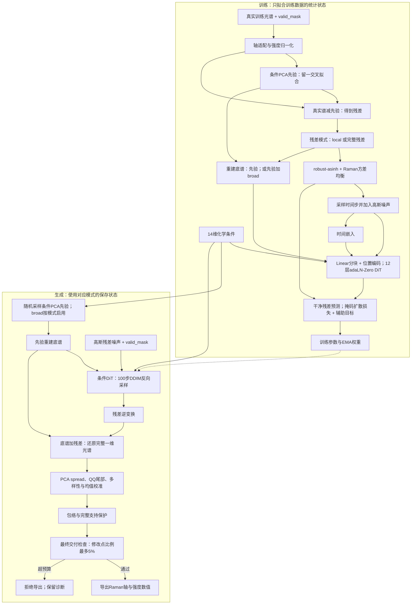
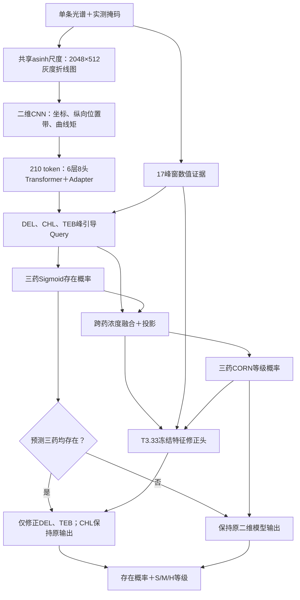

# DiT + Transformer：SERS 光谱生成与农药识别

本项目研究水、土壤基质中 DEL（溴氰菊酯）、CHL（百菌清）和 TEB（戊唑醇）的单药、双药、三药组合。系统包含两个独立训练的模型：**条件先验残差 DiT 生成一维光谱，SERSFormer 识别农药类别并预测 S/M/H 浓度等级**。

当前分支：`DiT+transformer`。本次更新识别端：**T3.32二维折线谱图CNN＋Transformer，叠加T3.33第4轮三元DEL/TEB修正**。T3.35、T3.36是未超过当前模型的微调对照；T3.36已整合CUDA初始化一致性修复。生成端D4.27代码保持原样。

## 1. 先从哪里看

| 目的 | 查看位置 |
|---|---|
| 理解两个模型的组成和数据流 | 本 README 第 3、4 节 |
| 查询每个文件、文件夹的简要功能 | [完整功能索引](FILE_GUIDE.md) |
| 查看生成模型的核心实现 | [dit_1d.py](diffusion/src/dit_1d.py)、[model_builder.py](diffusion/src/model_builder.py) |
| 查看当前完整识别模型 | [统一入口](transformer/run_recognition.py)、[加载接口](transformer/current_recognition.py)、[二维主干](transformer/extensions/T3_32_Image_Recognition/image_model.py)、[三元修正](transformer/extensions/T3_33_Ternary_Correction/correction_model.py) |
| 查看正式参数 | [D4.27 配置](current_configs/D4.27)、[T3.32结构](current_configs/T3.32/model_config.json)、[T3.33验证指标](current_configs/T3.33/validation_metrics.json) |
| 查找训练、生成、评价入口 | [生成端说明](diffusion/README.md)、[识别端说明](transformer/README.md)、[实验扩展说明](packages/README.md) |

**当前推荐模型从 `transformer/current_recognition.py::load_checkpoint` 加载T3.33权重**，其中嵌入T3.32完整二维主干与原图像尺度。`transformer/Model_v2.py`和T3.30扩展保留为历史基础及迁移来源，不代表当前二维模型。仓库不包含服务器上的数据和已训练权重。

## 2. 文件夹和根目录文件

| 名称 | 简要功能 |
|---|---|
| [diffusion/](diffusion) | 生成端：条件先验、残差处理、DiT、扩散采样、保护与评价 |
| [transformer/](transformer) | 当前二维识别入口、T3.32～T3.36扩展、历史基础及分层评价 |
| [packages/](packages) | 配对实验调度、完整识别扩展及固定路径依赖 |
| [current_configs/](current_configs) | 正式生成配置、推荐识别结构和验证摘要 |
| [README.md](README.md) | 项目总说明、模块作用、流程图、参数和使用入口 |
| [FILE_GUIDE.md](FILE_GUIDE.md) | 所有文件和文件夹的逐项功能说明 |
| [CURRENT_MODEL.json](CURRENT_MODEL.json) | 当前模型版本、推荐权重位置与评价口径 |
| [SOURCE_SHA256.json](SOURCE_SHA256.json) | 当前文件的 SHA256 内容校验清单 |
| [ARCHIVE_VERIFICATION.json](ARCHIVE_VERIFICATION.json) | 原始归档的源码与实验包核验记录 |
| [CLEANUP_REPORT.json](CLEANUP_REPORT.json) | 旧补丁和副本的清理清单及验证结果 |
| [.gitignore](.gitignore) | 防止数据、权重、输出及缓存误提交 |

保留的 `vendor/archived` 是完整识别模型的运行与校验依赖。D4.27 的 `payload` 和 `test_fixtures` 分别供安装器和测试读取。它们有固定用途，不能按“同名”或“旧版本号”删除。

GitHub 文件列表右侧文字来自最后一次提交，并没有独立可编辑的文件备注字段。根目录文档与说明文件采用功能化提交说明；逐文件功能以 [FILE_GUIDE.md](FILE_GUIDE.md) 为准。受校验保护的代码保持原内容与历史。

## 3. 模型一：条件先验残差 DiT

### 功能

输入化学条件、随机噪声和训练先验，输出 Raman 轴与强度数值组成的光谱。网络学习真实光谱相对条件底谱的残差，再将生成残差与底谱相加还原完整光谱。126 个条件共享一个条件 DiT 网络，各条件的 PCA 与残差状态只使用该条件 12 条真实训练谱拟合。

| 残差模式 | DiT 学习内容 | 光谱重建 |
|---|---|---|
| `broad_local` | 高斯分解后经缩放的 local 残差 | 外层 PCA 先验 + broad PCA 采样 + local 逆变换 |
| `full_residual` | 经缩放的完整先验残差 | 外层 PCA 先验 + 完整残差逆变换 |

两组使用同样的纯 DiT 骨架，分别训练、保存自己的残差尺度和 checkpoint。`full_residual` 不做 broad/local 拆分；残差均为实值一维数据。

### 模块和作用

| 模块 | 主要文件 | 作用 |
|---|---|---|
| 光谱读取、轴适配与掩码 | `spectrum_file_reader.py`、`spectrum_length_adapter.py`、`spectrum_dataset.py` | 统一物理轴并标记未实测区域，避免填充值参与有效区学习 |
| 强度归一化 | `intensity_normalizer.py` | 训练有效点拟合 global min-max，保存正反变换状态 |
| 条件 PCA 先验 | `conditional_prior_residual.py`、`prior_residual.py` | 保存各条件均值、PCA 变化和先验底谱；训练采用留一交叉拟合 |
| 残差处理 | `broad_local_residual.py` | 选择 local 或完整残差，执行 robust-asinh 和 Raman 方差均衡 |
| 条件编码 | `spectrum_conditioning.py` | 将农药、等级、组合与基质解析为 14 维条件 |
| Linear 分块与位置编码 | `dit_1d.py` | 将带噪残差、掩码和底谱按每 8 点投影为 token，保持 Raman 顺序 |
| 时间、条件与 adaLN-Zero | `dit_1d.py` | 时间和化学条件的嵌入相加，调制各层注意力与 MLP |
| 全局自注意力 | `DiTBlock` | 学习不同峰段和全光谱之间的联系，排除完全无效 patch |
| 掩码扩散与训练 | `masked_diffusion.py`、`ddpm_trainer.py` | 正向加噪、干净残差预测、min-SNR 权重、EMA 与模型保存 |
| 条件多样性和质量目标 | `conditional_diversity_constraints.py`、`conditional_spectrum_constraints.py` 等 | 在配置预算内约束成对残差几何、方差、重建与完整光谱支持 |
| 校准、交付和评价 | `spectrum_generator.py`、`final_spectrum_delivery.py`、`sers_generation_evaluator.py` | 校准生成分布，保护强度和负谷，评价相似性、分布和多样性 |

DiT 核心使用 Transformer，没有卷积去噪层、U-Net 编解码和 VAE。仓库中的旧 U-Net 模块用于兼容与对照，并非当前 DiT 的去噪骨架。

正式配置开启条件多样性和 `quality_fidelity`。独立物理约束、独立峰导数、相对峰强、峰参数、局部峰分布及峰形多样性项关闭；源码中存在某模块不等于当前实验启用了它。

### 机理流程图

最终生成依次经过 PCA spread、QQ 尾部与多样性保护、均值、包络及完整支持保护。终端交付检查最多允许修改 5% 的点，超预算时拒绝导出，不能自动放宽阈值。

## 4. 模型二：二维折线谱图 CNN＋Transformer 识别

### 功能

输入单条数值光谱，按保存的共享强度尺度绘制2048×512灰度折线谱图，输出DEL/CHL/TEB存在概率及S/M/H浓度等级。默认保留17峰窗口数值证据，是**图像＋数值辅助**模型。图中没有标题、坐标文字、类别、浓度标签或基质标签。

| 模块 | 主要文件 | 作用 |
|---|---|---|
| 固定尺度折线谱图 | T3.32 `image_data.py` | 600–2500 cm⁻¹横轴；真实训练集共享asinh纵轴，保留峰高、负值和强度差异 |
| 二维CNN | T3.32 `image_model.py` | 提取曲线局部形态；坐标通道、8个纵向位置带与曲线矩保留峰高信息 |
| Encoder＋Adapter | `image_model.py`、`adapter.py` | 210个位置token，128维，6层8头全局注意力，保留128→16→128残差Adapter |
| 峰引导Query | `ImageQueryAttention` | 三药独立Query，结合化学和训练峰先验聚合波段信息 |
| 多峰数值辅助 | `intensity_evidence.py` | 17峰窗口曲线与统计量作为浓度证据，实测掩码排除未测尾部 |
| 分类与浓度融合 | `ImageSERSFormer` | Sigmoid分类；浓度分支融合跨药信息及预测存在概率 |
| 有序等级头 | `spectral_core.py` | 条件CORN监督；累计概率median解码为S/M/H，而非连续浓度回归 |
| T3.33冻结三元修正 | `correction_model.py` | 冻结第16轮二维模型，371维谱源特征驱动23,940参数修正头，仅调预测三元的DEL/TEB |
| T3.34只读诊断 | `run_diagnosis.py` | 比较真实/生成训练及验证错误，检查有限修正幅度的约束 |
| T3.35等级头对照 | `run_heads.py` | 仅训练复制的DEL/TEB等级头；没有合格提升，未替代T3.33 |
| T3.36浓度分支对照 | `run_fusion.py` | 复制融合/投影/等级头，分层低学习率；没有合格提升，未替代T3.33 |

所有图共用同一训练集拟合尺度，不按单条光谱拉伸峰高。原1401点谱的未实测尾部不绘制，数值证据也保留实测掩码。T3.33特征包括三药浓度投影、原logits/分类概率、多峰统计量及可用性；推理不输入标签、文件名或条件ID。

### 机理流程图

这里的二维CNN、Transformer和峰证据属于T3.32；当前T3.33只训练三元修正头。T3.35/36继续冻结图像主干，其最新权重只供对照，不能当成当前最优模型。混合峰通过多波段和跨药信息辅助判级，模型不输出解混后的纯农药光谱。

## 5. 正式参数与数据约定

| 项目 | 生成端 D4.27 | 当前识别端 T3.32＋T3.33 |
|---|---|---|
| 输入空间 | 一维光谱残差与底谱 | 2048×512灰度折线谱图＋多峰数值证据 |
| 网络参数 | 57,922,056 | T3.32主干1,399,975；T3.33合计1,423,915 |
| 主干 | 12层DiT，hidden512，8头，patch8 | 二维CNN，128维，6层Encoder，8头，210 token |
| 图像强度尺度 | 不适用 | 真实训练集拟合共享asinh映射，保存尺度用于部署 |
| 基础训练 | 50 epoch，batch16，seed2026 | T3.32最多50轮，第28轮早停，保留第16轮 |
| 当前微调 | DiT训练 | T3.33仅23,940参数修正头，保留第4轮 |
| 学习率与调度 | 2e−4，warmup＋cosine | T3.33 1e−4→1e−6，3轮warmup＋cosine |
| 输出 | Raman轴与强度数值 | 三药存在概率与S/M/H浓度等级 |

真实数据固定为 126 源文件 × 20 条，共 2520 条。每源文件 1–12 条训练、13–16 条验证、17–20 条测试，对应 **1512/504/504**。这是同源文件内部划分，不是独立样品或独立批次验证。

原始轴为 1901 点（600–2500 cm⁻¹）或 1401 点（600–2000 cm⁻¹）。生成端对未实测区使用有效区掩码；识别端在内存中按既定背景策略补齐短轴，同时保留实测掩码，不写回原始数据。

PCA、残差状态、训练峰先验与多峰归一化使用对应训练数据拟合。当前 T3.32基础训练使用真实1512条＋既有生成6048条（每条件 48 条），验证为真实 504 条；这不是 D4.27 新生成谱的下游增益实验。

## 6. 当前结果及报告口径

### 生成端

每条件目标生成 100 条。原 5% 交付阈值下，broad/local 获准 125/126 条件，完整残差获准 116/126 条件。下面仅比较两组**共同获准的 116 条件、验证口径、条件均值再平均**：

| 指标 | broad/local | 完整残差 |
|---|---:|---:|
| 最近验证参考谱 RMSE，原始强度 | 13.4614 | 13.7879 |
| 最近验证参考谱 PCC | 0.968204 | 0.966395 |
| 最近验证参考谱 Cosine | 0.972252 | 0.970695 |
| 成对 MSE 多样性比，接近 1 为匹配 | 1.00716 | 1.08980 |

这些结果不能当成全部 126 条件的完整交付表现。未获准中间光谱只供诊断；相似性高不等于峰形、尾部和多样性全部达标。两种残差缩放域不同，不直接比较训练 loss 的绝对值。

### 识别端

当前保留T3.33第4轮。以下均为504条真实**验证集**结果：

| 指标 | 旧T3.30 | T3.32第16轮 | 当前T3.33第4轮 |
|---|---:|---:|---:|
| 成分组合全部正确 | 503/504，99.80% | 504/504，100% | 504/504，100% |
| 已存在成分等级正确 | 985/1152，85.50% | 1026/1152，89.06% | 1027/1152，89.15% |
| 类别与全部等级完整正确 | 380/504，75.40% | 406/504，80.56% | 408/504，80.95% |
| 三元三药等级全部正确 | 125/216，57.87% | 131/216，60.65% | 133/216，61.57% |

当前DEL/CHL/TEB等级正确数分别为332/363/332，各384个。单药完整72/72，双药203/216，三药133/216。

T3.35、T3.36均未通过超过当前模型的验收，最终回退T3.33。T3.36真实训练三元最高80.25%，验证最高61.57%，仍有明显训练—验证差距。其最新候选与保留模型分别导出报告，避免混淆。

这些版本同时涉及前端、迁移和优化配置变化，不是只改变“是否转图”的受控消融，不能将全部增益归因于图像。验证集已多次用于模型选择，未提供本轮测试成绩；S/M/H是等级，不能写成连续浓度预测精度。T3.36目前仅有用户终端记录摘要，正式报告ZIP尚未纳入。

## 7. 训练、生成、评价与加载

| 操作 | 入口 |
|---|---|
| 准备 DiT 两组实验 | `packages/d4_27_dit_ablation/prepare_run.py` |
| 生成端训练/管线检查 | `diffusion/scripts/start_ddpm_training.py` |
| 逐条件生成与交付 | `diffusion/scripts/generate_conditional_spectra.py` |
| 两组串行/并行调度 | `run_experiment.py` / `run_parallel.py`，位于 D4.27 实验包 |
| 生成分层评价 | `diffusion/scripts/evaluate_d4_2_generation.py` |
| 当前推荐识别模型加载 | `transformer/current_recognition.py::load_checkpoint`，读取T3.33 checkpoint |
| 当前识别检查、训练、诊断与微调对照 | `transformer/run_recognition.py --stage correction/image/diagnosis/heads/fusion` |
| T3.31 对照追溯 | `packages/sers_t331_target_aligned/run_aligned.py` |

二维识别的仓库相对路径命令、现有服务器项目复用与部署示例见[transformer/README.md](transformer/README.md)。各扩展包README保留最初的独立补丁路径说明。一般生成使用 GPU 1，识别使用 GPU 0；两组 DiT 并行另有双卡分配。推荐继续使用已验证的 `sers_ddpm` 环境。

运行时须指定正确配置、数据与权重路径。配置快照保留原服务器绝对路径；换环境需显式调整。`diffusion/` 和 `transformer/` 分别对应原服务器 `/home/wqzheng/project` 与 `/home/wqzheng/project_transformer`。

旧 U-Net checkpoint 不能加载到 DiT，两种残差模式的尺度与 checkpoint 不可互换。仓库没有原始光谱、生成光谱或已训练权重；推荐权重位置与 SHA256 见 `CURRENT_MODEL.json`。生成输出数值光谱，识别端将其绘制成二维折线谱图；两模型独立训练，没有联合反向传播。当前没有实现STFT/CWT转图。

## 8. 校验、清理与来源

清理删除了 185 个无当前依赖的旧文件，保留了完整模型与测试所需副本，并补齐 3 个实验清单必需日志。清单、源码语法、D4.27 安装器和调度检查结果见 `CLEANUP_REPORT.json`。历史版本可从 Git 历史恢复。

本次识别更新新增统一入口、T3.32～T3.36源码及模型/验证快照，整合T3.36初始化零更新修复。既有生成端、历史识别基础与vendor运行依赖保持原样；旧清理报告和归档验证是历史记录。当前内容校验以更新后的`SOURCE_SHA256.json`及扩展包校验文件为准。

DiT 适配参考 [官方 DiT 实现](https://github.com/facebookresearch/DiT)，具体许可与来源见 D4.27 包内 `DiT_LICENSE.txt`、`THIRD_PARTY_NOTICES.md`。基础识别上游来源及许可见 `transformer/README.md` 和 `transformer/LICENSE`。
