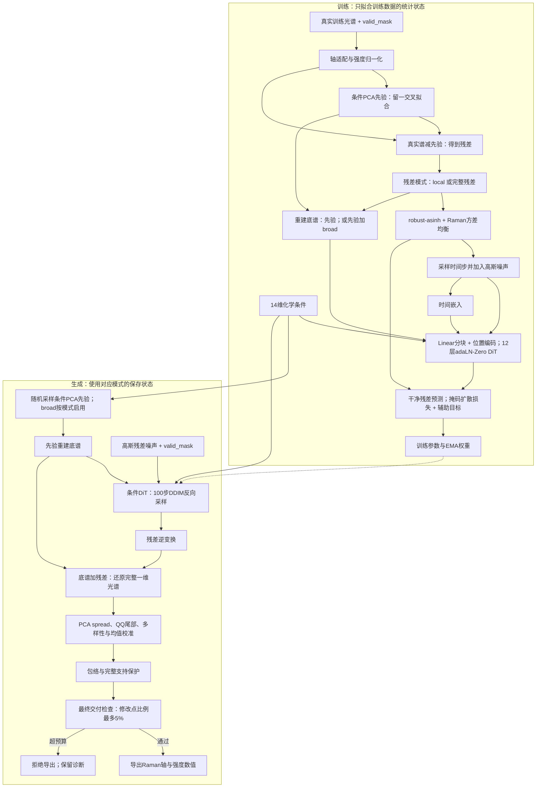
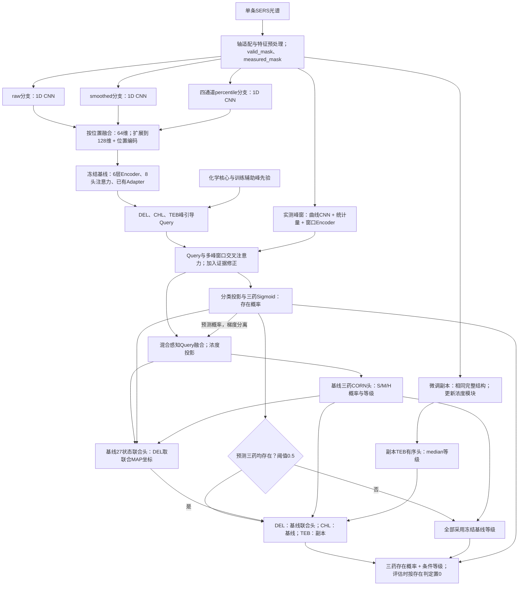

# DiT + Transformer：SERS 光谱生成与农药识别

本项目面向水、土壤基质中的 DEL（溴氰菊酯）、CHL（百菌清）、TEB（戊唑醇），覆盖单药、双药和三药组合。系统由两个独立训练的模型组成：**条件先验残差 DiT 负责生成光谱，SERSFormer 负责判断农药是否存在并预测 S/M/H 浓度等级**。

本分支 `DiT+transformer` 归档 2026-10-14 提供的服务器源码，保留 D4.27 的两种残差对照，并补充与实际报告哈希一致的识别实验扩展。当前推荐识别模型为 **T3.30 / concentration / TEB_only / epoch 17**；T3.31 的候选未取代它。

| 模型 | 输入 | 输出 | 当前核心 |
|---|---|---|---|
| 光谱生成 | 化学条件、随机噪声、训练集拟合的条件先验、有效区掩码 | Raman 轴与强度数值组成的一维光谱 | 纯一维 DiT + 条件 PCA 先验残差扩散 |
| 农药识别 | 单条光谱及其有效区、实测区掩码 | DEL/CHL/TEB 存在概率、S/M/H 等级 | 三分支 CNN + Encoder-Only Transformer + 峰引导 Query + 多峰证据 + 有序等级头 |

两个模型通过光谱数据衔接，当前没有联合反向传播。生成端输出数值光谱，识别端读取数值光谱；STFT、CWT、二维图像扩散均未在本版本实现。

## 1. 目录与版本对应

| 目录或文件 | 内容 |
|---|---|
| `diffusion/src/` | 生成端网络、先验、残差处理、掩码扩散、损失和生成保护 |
| `diffusion/scripts/` | 训练、条件生成、评价、划分与掩码检查入口 |
| `diffusion/tests/` | 原有模块及 D4.27 回归测试 |
| `transformer/` | 服务器基础数据适配器、基础 SERSFormer、训练和评价代码 |
| `packages/d4_27_dit_ablation/` | D4.27 两组实验的准备、串行/并行运行和补丁参考 |
| `packages/sers_t330_feature_finetune/` | 当前推荐识别模型的完整扩展、加载器与微调入口；含所需旧版模型和 Adapter、联合头依赖 |
| `packages/sers_t331_target_aligned/` | 最新目标对齐对照实验，含自带的 T3.30 依赖；供追溯，当前不推荐替代 T3.30 |
| `current_configs/D4.27/` | 两组正式实验的 runtime 配置快照 |
| `current_configs/T3.30/` | 已接受识别模型的结构配置和验证摘要 |
| `CURRENT_MODEL.json` | 当前版本、推荐模型及来源信息 |
| `SOURCE_SHA256.json` | 本次归档文件的 SHA256 与来源 |

`transformer/Model_v2.py` 是基础实现。**当前完整识别模型必须通过 T3.30 扩展加载**，不能只实例化基础模型就认为已包含多峰、Adapter、联合头和最终解码策略。`diffusion/config/` 保留可运行的历史对照配置，`current_configs/D4.26/` 保留 D4.27 所用基础配置；旧 U-Net 模型代码也保留兼容路径。

2026-10-14 清理已应用补丁、一次性安装器、备份、旧源码转储和被当前扩展取代的独立实验包，共删除 185 个文件。旧版本仍可从 Git 历史恢复。当前模型代码、正式配置、训练/生成/识别入口均未修改；保留当前模型的 vendor 依赖及 D4.27 安装/测试所需 payload、fixtures。补齐 3 个被实验包 MANIFEST 强制校验的原始日志。详细清单与验证结果见 [CLEANUP_REPORT.json](CLEANUP_REPORT.json)。

本分支保存源码、配置及必要实验参考文件。原始光谱、生成光谱、训练权重、服务器运行输出不在上传范围内。

## 2. 数据与输入约定

- 真实数据：126 个源文件，每文件 20 条光谱，共 2520 条；water/soil 两种基质。
- 固定划分：每源文件 1–12 条训练、13–16 条验证、17–20 条测试，即 1512/504/504。
- 原始 Raman 轴：1901 点（600–2500 cm⁻¹）或 1401 点（600–2000 cm⁻¹）。
- 生成端：使用统一物理轴与 `valid_mask`；未测区不参与先验拟合、扩散损失或有效区评价。
- 识别端：数据适配器在内存中将短轴谱补齐到统一 1901 点，沿用背景匹配噪声策略；`measured_mask` 记录真正实测区，多峰窗口只使用完整实测窗口。补齐不写回原始文件，也不等于新增真实峰。
- PCA、残差尺度、训练数据峰先验和多峰归一化仅在相应训练数据上拟合；推理沿用保存状态。
- 当前 T3.30 实验训练集为真实 1512 条 + 生成 6048 条（126 条件各 48 条），共 7560 条；验证 504 条真实谱。生成数据来自既有生成目录，不能据此声称已验证 D4.27 新生成谱的下游增益。

这套 12/4/4 是同一源文件内部的光谱划分，不能表述为独立样品、独立批次或外部数据泛化测试。

## 3. 模型一：条件先验残差 DiT

### 3.1 功能和学习目标

生成端保留原来的条件先验、PCA、残差尺度、条件掩码和生成保护，将去噪骨架替换为纯 Transformer。它学习的是**真实光谱相对先验底谱的残差分布**，采样后再还原成完整光谱。

每个化学条件只使用该条件的 12 条真实训练谱拟合先验；126 个条件共享一个条件 DiT 网络。训练先验采用留一交叉拟合，减少样本用自身拟合先验后残差过小的问题。14 维条件向量编码当前数据中的农药、等级、组合和基质信息；具体排列由 `spectrum_conditioning.py` 与保存配置定义。

### 3.2 两种残差模式

| 步骤 | `broad_local` | `full_residual` |
|---|---|---|
| 外层先验 | 条件 PCA 先验 | 相同条件 PCA 先验 |
| 原始残差 | 真实谱减外层先验 | 真实谱减外层先验 |
| 残差处理 | 高斯滤波得到 broad；剩余部分为 local | 保留完整先验残差 |
| broad 随机变化 | 由 broad PCA 拟合和采样 | 不运行，broad 为零 |
| 输入 DiT 的底谱 | 外层先验加 broad | 外层先验 |
| DiT 学习目标 | 缩放后的 local 残差 | 缩放后的完整残差 |
| 完整光谱重建 | 外层先验 + broad + 逆缩放 local | 外层先验 + 逆缩放完整残差 |

这里的 broad/local 是慢变化与局部细节分解，均为实值一维光谱；与 STFT 的实部/虚部无关。`full_residual` 保留残差接口的 `enabled: true` 是代码兼容设计，不表示仍然做 broad/local 拆分。

### 3.3 模块及作用

| 模块 | 实现位置 | 作用及当前状态 |
|---|---|---|
| 光谱读取与物理轴适配 | `spectrum_file_reader.py`、`spectrum_dataset.py`、`spectrum_length_adapter.py` | 统一轴和长度，保留真实有效区掩码 |
| 全局强度归一化 | `intensity_normalizer.py` | 仅训练有效点拟合 global min-max，目标范围 −1 到 1，保存逆变换状态 |
| 条件 PCA 先验库 | `conditional_prior_residual.py`、`prior_residual.py` | 为各条件保存均值、PCA 与残差状态；训练留一交叉拟合，生成时随机采样先验变化 |
| broad/local 或完整残差 | `broad_local_residual.py` | 决定学习域；两种模式分别保存自己的尺度与先验状态 |
| robust-asinh 与 Raman 方差均衡 | `prior_residual.py`、`broad_local_residual.py` | 缓和残差极值及不同波数位置的尺度差异；生成时用对应状态逆变换 |
| Linear patch embedding | `dit_1d.py / SpectrumDiT1D` | 将带噪残差、掩码和先验底谱拼接，每 8 点投影为一个 token |
| 位置、时间、条件编码 | `dit_1d.py` | 固定正余弦位置编码保持 Raman 顺序；时间 MLP 与 14 维条件 MLP 的输出相加，得到调制向量 |
| adaLN-Zero DiT Block | `dit_1d.py / DiTBlock` | 条件调制 LayerNorm、自注意力和 MLP；门控残差与调制层零初始化，使网络从稳定状态开始学习 |
| 全局自注意力 | `DiTBlock` | 建模相距较远峰段与整体光谱的联系；完全无效 patch 不作为注意力 key |
| 输出投影与还原 | `SpectrumDiT1D` | token 投影回光谱点，裁去补齐点，输出有效区干净残差预测 |
| 掩码扩散与训练器 | `masked_diffusion.py`、`one_dimensional_ddpm.py`、`ddpm_trainer.py` | 正向加噪、`pred_x0` 目标、min-SNR 权重、EMA、验证与 checkpoint 管理 |
| 条件分组与多样性目标 | `condition_grouped_batch_sampler.py`、`conditional_diversity_constraints.py` | 在同条件有效区比较低噪声残差几何、成对距离/相关性和方差，缓解仅强度缩放或多样性收缩 |
| 质量与分布目标 | `conditional_spectrum_constraints.py` 等，由 `model_builder.py` 接入 | 当前开启 `quality_fidelity`，包含配置指定的多尺度、导数、条件均值、包络和完整光谱支持等目标，辅助权重受预算限制 |
| 采样校准与保护 | `sers_sampling_calibrator.py`、`final_spectrum_delivery.py` 与生成入口 | 依次进行 PCA spread、QQ 尾部与多样性保护、均值、包络、完整支持保护和最终交付检查 |
| 评价与阶段追踪 | `sers_generation_evaluator.py`、`generation_stage_trace.py`、评价脚本 | 输出相似性、QQ、Wasserstein、峰形、成对多样性及保护诊断 |

正式配置中独立 `physics_constraints`、`peak_derivative_constraints`、`relative_peak_intensity_constraints`、`peak_parameter_constraints`、`local_peak_distribution_constraints` 和 `peak_morphology` 多样性项均关闭。不能因为源码存在这些模块就写成全部启用；`quality_fidelity` 内的导数项与独立峰导数模块是不同开关。

DiT 去噪核心不包含 Conv1d、U-Net 编解码、上下采样或 U-Net 跳跃连接；PCA 和后处理仍是网络外的光谱处理模块。模型直接在光谱残差空间工作，没有使用图像 VAE。

### 3.4 生成端机理流程图

实线表示光谱或条件的数据流，虚线表示训练得到的参数供采样使用。

图中 `broad_local` 的 local 与 broad 来自同一次残差分解；`full_residual` 不运行 broad PCA。采样调用相同架构的已训练 DiT，每一步都提供时间、化学条件、底谱和掩码。最终检查必须位于全部校准之后，拒绝条件不能自动放宽阈值。

### 3.5 正式参数与结果范围

| 项目 | D4.27 两组共同设置 |
|---|---|
| 去噪核心参数量 | 57,922,056 |
| DiT | 12 层，hidden 512，8 头，MLP ratio 4，patch 8 |
| 长轴 token | 1901 有效点补到 1904 点，共 238 个 patch；补齐点被掩码 |
| Dropout / 梯度检查点 | 0.05 / 开启 |
| 训练预算 | 50 epoch，batch 16，seed 2026 |
| 学习率 | 2e−4；warmup + cosine；最低 1e−6 |
| EMA / 混合精度 | 0.995 / 正式配置关闭 |
| 扩散 / 采样 | 200 扩散步，100 DDIM 采样步，eta 0，`pred_x0` |
| PCA | 最大 6 主成分，解释方差目标 0.95，score 截断 2.5 个标准差 |
| 生成目标 | 每条件 100 条；126 条件目标共 12,600 条/组 |

两种模式的缩放域不同，不直接用训练 DDPM loss 的绝对值比较质量，应比较还原后的完整光谱。

正式交付保护保持 5%：broad/local 获准 125/126 条件，完整残差获准 116/126 条件，以下仅为两组共同获准的 **116 条件子集、验证口径、条件均值再平均**：

| 指标 | broad/local | 完整残差 |
|---|---:|---:|
| 最近验证参考谱 RMSE（原始强度） | 13.4614 | 13.7879 |
| 最近验证参考谱 PCC | 0.968204 | 0.966395 |
| 最近验证参考谱 Cosine | 0.972252 | 0.970695 |
| 成对 MSE 多样性比（接近 1 为匹配） | 1.00716 | 1.08980 |

这是通过保护后子集的评价，不能当成全部 126 条件的完整交付结果，也不能只凭高 PCC/Cosine 宣称峰形、尾部和多样性全部达标。被拒绝条件的中间光谱仅用于诊断，不用于下游训练。

## 4. 模型二：SERSFormer 农药识别与等级预测

### 4.1 基础结构与完整识别模型

SERSFormer 是 Encoder-Only 多任务模型。先从原始、平滑、百分位三类输入提取局部特征，再由 Transformer 学习跨峰联系。每种农药拥有一个可学习 Query，从全光谱提取各自证据，并预测是否存在与浓度等级。

完整模型在基础结构上加入注意力扩维、多峰窗口证据和已训练 Adapter；随后保留冻结基线及微调副本，实现对三元混合物的受控等级改进。完整加载链为：

`feature_model.FeatureModel` → `combined_model.DELOnlyModel` → `ternary_model.TernaryModel` → 归档 `Model_T3_26` + `peft.configure`。

### 4.2 模块及作用

下表中“扩展”文件均可从 `packages/sers_t330_feature_finetune/` 的 `vendor/` 目录定位。

| 模块 | 实现位置 | 作用 |
|---|---|---|
| 数据、物理轴与掩码 | `transformer/Dataset.py` | 读入单条光谱，生成 `raw`、`smoothed`、`percentile`、`raw_intensity`、`valid_mask`、`measured_mask` 六个网络输入 |
| 三分支 CNN | 基础 `Model_v2.py`；完整网络用扩展 `Model_T3_26.py` | raw 与 smoothed 各一条 Conv1d 路径；percentile 路径输入 95/85/75/50 四种百分位通道，保留不同强度层次的特征 |
| token 融合与扩维 | 扩展 `Model_T3_26.py` | 三路特征按位置拼接；融合为 64 维，再投影到 128 维注意力空间；1901 点对应原 210 token 路径 |
| 正余弦位置编码 | `Model_T3_26.py` | 保留 Raman 位置顺序，避免只看强度而丢失峰所在位置 |
| 六层 Transformer Encoder | `Model_T3_26.py` | 8 头全局自注意力；学习峰段之间及背景与峰的关系；屏蔽无效 token |
| 已训练 Residual Adapter | 扩展 `peft.py` | 每层 Encoder 输出后接 LayerNorm、128→16→128 的残差适配器；当前继承 Adapter 权重，T3.30 concentration 组不继续更新它 |
| 峰引导 Query Attention | `Model_T3_26.py / PeakGuidedQueryAttention` | DEL/CHL/TEB 各一个 Query；化学核心峰与训练辅助峰先验作为正向软偏置，所有有效波段仍可被关注 |
| 多峰窗口证据 | 扩展 `MultiPeak_T3_25.py / MultiPeakEvidence` | 17 个峰窗，半宽 24 cm⁻¹；原始曲线与局部背景扣除曲线经 CNN 编码，结合 9 个统计量、窗口位置、窗口 Transformer 与 Query 交叉注意力 |
| 实测窗口保护 | `MultiPeakEvidence` | 用 `measured_mask` 排除未完整实测的窗口，例如短轴谱没有真实 2230 cm⁻¹ 峰；训练归一化只拟合真实训练谱 |
| 分类投影与 Sigmoid 头 | `Model_T3_26.py` | 注意力特征由 128 回到 64 维，分别输出三药存在概率，多标签允许同时存在多种农药 |
| 混合感知 Query 融合 | `MixtureAwareQueryFusion` | 浓度路径进行跨药 Query 交互，使用预测存在概率进行融合；不将真实类别作为输入，不反向通过该概率更新分类分支 |
| 浓度投影与 CORN 头 | `Model_T3_26.py` 及相关损失 | 浓度特征回到 64 维；每药两个条件 logit，形成“≥M”和“≥H”的单调概率，只对存在农药计算相应训练任务 |
| 三元 27 状态联合头 | 扩展 `ternary_model.py / JointHead` | 将三药 S/M/H 的 27 种组合联合评分；独立等级先验的 log 概率加有界网络修正，以利用组合关系 |
| 冻结基线的 DEL-only 策略 | `combined_model.py` | 预测三药存在时取基线联合 MAP 的 DEL 坐标；其余药仍由基线有序头给出 |
| T3.30 微调副本与路由 | `feature_model.py` | 保留冻结基线，复制现有识别网络；仅微调指定浓度模块，当前 TEB_only 只替换三元路由内的 TEB 等级 |
| 学习率与参数锚定 | `feature_model.py`、`run_feature.py`、扩展 `schedule.py` | AdamW 分组学习率、3 epoch warmup + cosine、L2-SP 参数偏移约束，防止微调过度偏离已接受模型 |
| 评价与候选保护 | `run_feature.py`、基础 `Metric.py`/`Inference.py` | 验证类别、存在药物等级、完整结果、一/二/三元、water/soil 和各药表现，通过保护后才接受候选 |

多峰统计包含强度、局部均值、背景、斜率、负向残差、窗口均值、质心、宽度及相对高度等信息；它们是窗口证据，不能当成已经分离出的纯组分峰。重叠峰识别利用的是整条光谱的联合证据，不是物理解混后输出各农药纯光谱。

当前使用 Adapter；LoRA 是保存的对照实现，未与 Adapter 同时启用。自适应混合门控、边界独立门控均关闭；跨组合关系投影保留历史结构，但 T3.27 后续实验中关系损失关闭，当前 T3.30 训练也不使用它。基础代码的旧局部定量分支和锚定校准是可选历史路径，不等同于当前 17 窗多峰分支。

### 4.3 识别端机理流程图

图中展开冻结基线的结构；微调副本拥有相同完整主干和独立权重，两条网络分别计算。当前部署模式为 TEB_only。

路由只看模型预测的存在概率，不读取真实浓度、真实组合、文件名或基质标签。当前 TEB_only 保留的是已接受 DEL-only 基线，所以 DEL 的联合修正仍然存在；TEB_only 不表示网络只识别 TEB。

训练阶段，微调副本还通过冻结的联合头计算 27 状态得分以获得特征监督；当前 TEB_only 推理不以副本联合得分替换 DEL。DEL 的最终等级可能与其边缘概率再次 median 解码的结果不同，因此必须使用完整模型 `predict()` 返回的等级。

### 4.4 当前参数、训练与输出含义

| 项目 | 当前识别模型 |
|---|---|
| 光谱 / token | 1901 点 / 210 token |
| CNN 基础宽度 / 融合维度 | 32 / 64 |
| 注意力维度 / Encoder / 头 | 128 / 6 层 / 8 头 |
| FFN / Dropout | 256 / 0.1 |
| 多峰分支 | 17 窗，半宽 24 cm⁻¹，修正强度 0.25 |
| Adapter | 每层残差 Adapter，bottleneck 16；本轮继承并冻结 |
| 有序头 / 联合头隐藏维度 | 64 / 64 |
| 完整 T3.30 模型总参数量 | 3,100,203，包含冻结基线与副本 |
| 当前 concentration 组更新参数 | 148,807；浓度投影、混合融合、DEL/TEB 等级头 |
| last_encoder 对照更新参数 | 285,783，额外包含第 6 层及其 Adapter；不是当前推荐组 |
| 训练预算 / 接受点 | 50 epoch，batch 16，seed 2026 / epoch 17 |
| 学习率 | 浓度特征 5e−6，等级头 1e−5；3 epoch warmup + cosine，最低为各组最大值的 0.01 |
| 当前微调损失 | 三元 27 状态交叉熵 + 0.5 × TEB CORN + 0.01 × L2-SP；交叉熵标签平滑 0.05 |

该轮每 epoch 读取固定训练数据，监督损失按真实标签选取三元训练样本；训练标签只进入损失。冻结基线不更新，副本保持固定 dropout/归一化的 eval 行为但仍对指定参数求梯度。AdamW weight decay 为 0，L2-SP 将权重锚定到已接受模型。

输出为 **类别存在与浓度等级**。S/M/H 对应既定等级，等级码 MAE/RMSE 不等于 mg/L 等物理单位的连续浓度误差，不能仅凭这些指标宣称完成高精度连续定量。

## 5. 当前识别结果与解释

T3.31 对推荐 T3.30 checkpoint 的只读复核，使用 504 条真实**验证**光谱：

| 指标 | 正确数 / 总数 | 比例 |
|---|---:|---:|
| 三药类别组合全部正确 | 503 / 504 | 99.80% |
| 存在药物的浓度等级正确 | 985 / 1152 | 85.50% |
| 类别与全部等级完整正确 | 380 / 504 | 75.40% |
| 三元三药等级全部正确 | 125 / 216 | 57.87% |
| DEL 存在药物等级正确 | 312 / 384 | 81.25% |
| CHL 存在药物等级正确 | 351 / 384 | 91.41% |
| TEB 存在药物等级正确 | 322 / 384 | 83.85% |
| soil 完整正确 | 188 / 252 | 74.60% |
| water 完整正确 | 192 / 252 | 76.19% |

类别识别与完整浓度识别是不同指标；主要剩余误差在三元混合浓度判级。峰引导、多峰证据和组合头帮助模型利用共享峰以外的线索，但当前结果不证明重叠峰问题已完全解决。

当前验证集已多次用于候选比较和选择，上表应按探索性验证结果报告。T3.30/T3.31 本轮报告的测试预测次数为 0，不能把上述结果改称独立测试准确率，也不能混用历史 T3.24/T3.26 的数值。

## 6. 使用与复现入口

推荐继续使用服务器现有 `sers_ddpm` 环境。生成端依赖见 `diffusion/requirements.txt`，基础识别依赖见 `transformer/required_packges.txt`；实际训练环境以已验证服务器环境为准。

| 工作 | 入口 | 说明 |
|---|---|---|
| D4.27 准备两组配置 | `packages/d4_27_dit_ablation/prepare_run.py` | 从正式基础 runtime 配置准备 broad/local 与完整残差组 |
| 生成端训练或管线检查 | `diffusion/scripts/start_ddpm_training.py` | 必须指定对应配置；旧默认配置不会自动切换成 DiT |
| 条件生成 | `diffusion/scripts/generate_conditional_spectra.py` | 读取对应组 checkpoint、先验状态与 EMA，按条件导出 |
| 两组调度 | `packages/d4_27_dit_ablation/run_experiment.py`、`run_parallel.py` | 详见同目录 `README_CN.md`；双卡并行模式会同时占用两张卡 |
| 生成评价 | `diffusion/scripts/evaluate_d4_2_generation.py` | 根据指定真实 split、最终导出及有效区评价；诊断中间结果应单独标记 |
| 当前识别模型加载 | `packages/sers_t330_feature_finetune/feature_model.py` 的 `load_checkpoint` | 加载完整 T3.30 checkpoint 后调用 `model.predict(model(spectrum_inputs))` |
| T3.30 复核或微调 | `packages/sers_t330_feature_finetune/run_feature.py` | 详见同目录 `README_操作步骤.md`，保持原项目源文件与数据哈希 |
| T3.31 追溯 | `packages/sers_t331_target_aligned/run_aligned.py` | 最新对照实验，不自动取代已接受 T3.30 模型 |

常规任务分配为生成端 GPU 1、识别端 GPU 0；D4.27 两组并行实验另有独立 GPU 配置。归档 runtime 配置包含原服务器绝对路径，换机器需显式调整数据、输出、checkpoint 与项目参数。克隆目录中的 `diffusion/`、`transformer/` 分别对应原服务器 `/home/wqzheng/project`、`/home/wqzheng/project_transformer`。

旧 U-Net 权重不能加载到 DiT；broad/local 与完整残差组也不能交换残差尺度和 checkpoint。最终识别 checkpoint 的默认服务器位置与 SHA256 记录在 `CURRENT_MODEL.json`；仓库没有附带该权重，克隆源码不等于下载已训练模型。

## 7. 归档核验与方法参考

本次归档进行了以下核验：服务器生成端的 74 个报告源码哈希全部匹配；识别端五个核心源文件匹配 T3.31 报告；补充 T3.31 原实验包中报告记录的 34 个文件哈希全部匹配，且其中 T3.30 vendor 与独立 T3.30 包逐文件一致。源码内容按原样保存，本次没有重新训练或修改模型算法。

DiT 一维实现参考原包记录的 [DiT 官方代码](https://github.com/facebookresearch/DiT) 与论文 *Scalable Diffusion Models with Transformers*。本项目适配的是 Linear 分块、Transformer、时间条件和 adaLN-Zero 的设计，并保留光谱先验残差系统；具体许可见 `packages/d4_27_dit_ablation/DiT_LICENSE.txt` 和 `THIRD_PARTY_NOTICES.md`。识别端的基础许可见 `transformer/LICENSE`。
